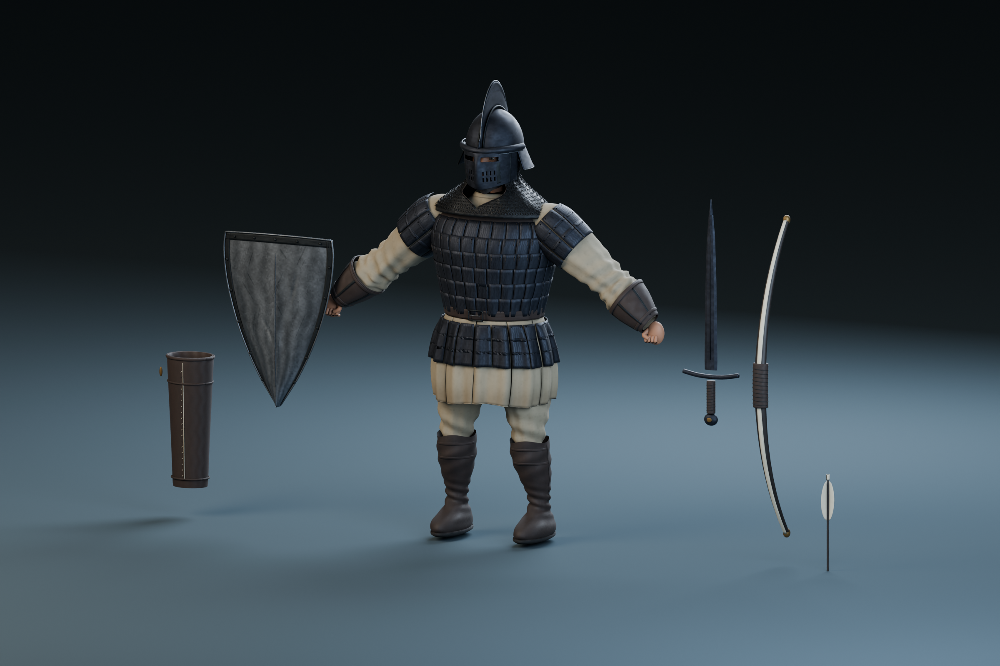

# Marchwarden — gladiator warrior

**Performance update: [frame-time improvements and responsive camera](Performance.md).**

**Latest rig: [anatomical hands, corrected handedness and continuous wrists](Hands.md).**
Palm-fitted weapon mounts, forearm-driven twist and wrist limits keep the hands
aligned during sword, shield and bow poses. The editable `.blend` uses Blender
compression so it can be stored directly in Git without Git LFS.

**Latest mesh: [structure, hinged hip armor and compact quiver](Structure.md).**
The warrior has a fuller upper body, an arched heater crown, rigid articulated
hip plates and a suspended quiver at the rear of the right hip.

**[Rapid sword combat and live cloth](CombatCloth.md).** The tunic uses
real-time cloth, a pinned belt and fitted leg/foot collision capsules. Twelve
rapid strikes share animation, damage and combo timings.

**[Gladiator helmet and taller stature](Gladiator.md).** The current helmet
has a swept steel crest, a protective face grille and cheek guards. The warrior,
his rig and equipment are uniformly 10% taller in Blender and Unity.

**Current revision: [cinematic warrior design, rigging and rebuild notes](Cinematic.md).**
It follows [the latest warrior render](References/Cinematic-warrior.png), with a
fuller build, folded linen sleeves, dark lamellar armor, linked mail, a refined
steel heater and four-influence skinning. The live cloth revision supersedes the
earlier spring-driven tunic motion. The notes
below document the earlier frontier/heater pass retained by the source pipeline.

The earlier frontier study follows the user's [s.jpg reference](../../s.jpg): conical
nasal helmet, visible face, mail hood and sleeves, fitted layered cuirass, split
tunic, tall leather boots and straight sword. The latest brief replaces the round
shield with an entirely forged-metal heater. The outfit and equipment
are authored in Blender. The current head and hands use adapted MakeHuman CC0 anatomy, with its
source and license retained in [Anatomy](Anatomy/README.md). No Toon RTS character
vertices or atlas are used by the replacement; its licensed skeleton and locomotion
clips remain in use.

[Gameplay](InGame.png) · [Unity close-up](Warrior-Unity.png) · [Blocking pose](Blocking.png) · [Toon RTS comparison](Comparison.png)

The palette uses weathered cool steel, undyed linen, distressed saddle leather,
oxblood bindings and restrained aged brass. The heater has a dished steel plate,
a reinforced iron border, heavy iron rivets, and forged iron rear fittings.
Vertical/diagonal gouges deform its surface, with additional scratch normals,
roughness variation and a rubbed bright rim. The preset is selected once when this art version
first runs; subsequent customization choices persist.

The earlier athletic heater revision reduced the torso expansion. Its chest was
about 24% narrower and 27% shallower than the previous bulky revision, with
smaller shoulder caps, restrained arm muscles and slimmer thighs/calves.
Continuous arm surfaces have blended elbow weights; boots have a continuous
toe, instep, ankle and calf. Linen folds carry baked occlusion and edge-bound
dirt. Leather has grain, fine scuffs and dirt near the soles.

`Marchwarden.blend` is the editable source, organized into Body, Tunic, WaistArmor, Sword, Shield,
Bow, Quiver and Arrow collections, with separate presentation copies and lighting.
The source includes a joint reference armature. Rigid equipment follows its joint;
shoulders blend between arm and spine, the mail hood blends between head and spine,
the tunic is pinned to the pelvis for live cloth, knees have flexible cloth gussets, and boot
ankles blend with the foot.

Regenerate from the repository root with Blender 4.5 LTS:

1. Unity: **Medieval Warrior > Marchwarden > Export animation rig reference**.
2. `blender --background --python Tools/ArtPipeline/marchwarden.py`.
3. Unity: **Medieval Warrior > Marchwarden > Import Blender exports**.
4. Unity: **Medieval Warrior > Rebuild sword animations**.

The local portable Blender is
`Artifacts/Tooling/blender-4.5.15-windows-x64/blender.exe`.
Runtime assets are in `Assets/Resources/Marchwarden`; the prefab is
`Assets/Resources/Prefabs/Marchwarden.prefab`. Existing scenes receive the visual
through `KnightAppearance`.

Source responsibilities:

- `marchwarden_frontier.py`: outfit, hands, helmet, mail, boots and equipment.
- `marchwarden_hands.py`: revised continuous palms, finger webs, knuckles, nails and explicit weapon grips; see [Hands.md](Hands.md).
- `marchwarden_anatomy.py`: customized CC0 anatomical head and fitted beard/eyes.
- `marchwarden_physique.py`: agile proportions and continuous fitted boots.
- `marchwarden_heater.py`: forged heater plate, raised rim, rivets, gouges and iron fittings.
- `marchwarden_forms.py`: smooth surface helpers and bow/quiver/arrow contracts.
- `marchwarden_cloth.py`: independent linen panels for real-time cloth simulation.
- `marchwarden_structure.py`: rigid hip armor joints, collision probes and compact quiver.
- `marchwarden_finish.py`: unique UV atlas, mesh-bound occlusion, edge wear,
  skin complexion variation, albedo, tangent normals and metal/smoothness.
- `marchwarden_harness.py`: retained earlier plate-harness study, unused by the current export.

Fourteen material regions share 4096px atlases. Steel, cloth, leather, mail, skin,
hair and eyes have distinct shading. Their source textures and exact generation
prompts are in [Materials.md](Materials.md). Mipmaps, trilinear filtering and
anisotropy filter surface detail; the menu portrait uses 1350 × 1800 and 8x MSAA.

Each region also retains its original surface coordinates in Unity UV1, with a
separate 1024px detail-albedo tile. Close-up leather grain and woven fibers no
longer rely solely on small atlas islands. Desktop imports explicitly use BC7
for color/surface maps and BC5 for normals, avoiding legacy DXT overrides.
Skin and fabric no longer bake the mesh's per-vertex curvature into their color;
that was accentuating polygon boundaries. The skin renderer retains two joint
weights even when the global graphics setting limits other meshes to one.

Equipment coordinates stay compatible with gameplay: sword/shield X is their long
axis and Z their face normal; the bow uses Y up and tips at ±0.62 m; the quiver
origin is its base; arrows point along +Z. Iron enarmes fit the forearm. The bow and
quiver retain their textured material maps when their finish colors change.

## Motion and validation

Twelve authored upper-body strikes retain moving legs. Hand trajectories have
separate anticipation, contact, follow-through and recovery; damage contact times
come from `SwordMoves`. Stable bend-plane IK avoids forearm roll flips. Quaternion
hemispheres, centered smoothing and finite-difference tangents remove rotation
spikes. The head counter-turns gently to keep attention forward.

A combo preserves the outgoing attack's layer weight and cross-fades for 50 ms.
It does not reset the pose to idle between strokes. The shield guard is a separate
arm layer for the sword and shield; it opens the shield ahead of the blade. Interrupted attacks and guard changes
fade their weights while gameplay cancels their pending hit immediately.

`ShieldDefensePose` owns the full-body block after the animation graph. It braces
the torso, lowers the pelvis and solves the legs while preserving both animated
foot contacts. The shield arm has analytic IK plus an orientation constraint.
Separate conservative bounds for the plate and rear fittings keep both outside
the measured chest armor. The neutral guard is fitted forward of the chest so
entering defense does not require an abrupt correction. The outer top corner protects
the head while both eyes retain a forward sightline over the inner corner.
The raised plate is also checked against a forward strike toward the sternum.

The old demo defend clip is disabled for this rig. Procedural transforms are
restored before the next Animator evaluation, preventing cumulative crouch/sink.
Chest axes and eye points come from the anatomical bind pose, not the pose that
happens to be active during `Start`.

**Medieval Warrior > Review sword and shield clearance** samples each strike at
180 Hz, tests all adjacent combo transitions across the input window, measures
actual glove vertices behind the shield, and checks per-sample joint rotation.
Conservative capsules cover blade, crossguard, grip and pommel; shield bounds
include the rim and rear iron fittings. The report is
`Artifacts/Marchwarden/sword-clearance.txt` in the validation project.

`MarchwardenBuilder.BuildAndSmoke` rebuilds the art and animation, runs the
authoring review and then the full gameplay regression. The latter measures live
weapon clearance and verifies the mid-combo weight retention that previously
caused a snap. It also checks locomotion, camera, blocking, bow aim/draw/release,
quiver ammo and gameplay effects. Defense checks measure chest clearance,
foot contact drift, both eye sightlines, sternum coverage, joint continuity and
pelvis restoration through block entry/hold/release. Reports are in `Artifacts/Marchwarden/AthleticSmoke/report.txt`
and `Artifacts/Marchwarden/sword-clearance.txt`.

The final heater revision passed **148 gameplay checks and 44 combat/defense
checks**, with no logged gameplay errors or exceptions. Live block clearance
remained at least 0.0286 m in the captured entry/hold/release sequence. The
authoring review includes the first frame of entry; its largest joint change
was 2.40 degrees per sampled blend step. [In-game defense](Blocking-InGame.png)
shows the final chest coverage and sightline.

`motion_preview.py --folder Artifacts/Marchwarden/AthleticSmoke` assembles actual
Unity captures into lossless animated PNGs. The captures are evidence for the
tested actions and transitions; they are not a guarantee for every possible input.
The block preview contains 28 actual Unity frames and is saved as
`Artifacts/Marchwarden/Preview-block.png`, alongside the sword and bow previews.
