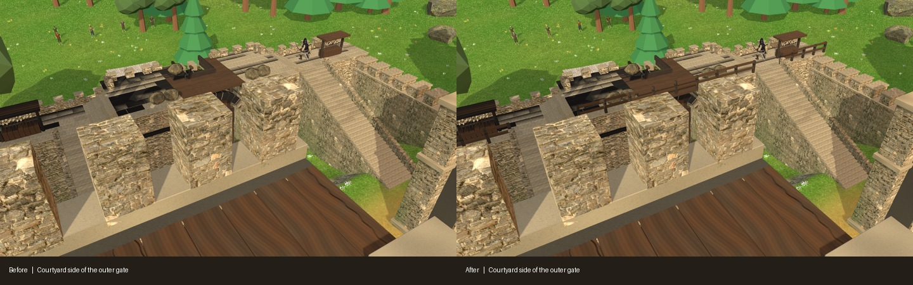

# Medieval Warrior 1.2 playtest and follow-up

Use this list when resuming the gameplay review. The baseline ratings below refer to the original Windows playtest. Record the build, evidence and remaining checks as fixes land.

## Reviewer findings and test order

| Priority | Finding from the original playtest | Reproduction or next test |
| --- | --- | --- |
| 1 | Windows reported a crash on Quit after visiting several modes. | Compare a cold title quit with defeat, restart, mode changes and return to title. Inspect the player and Windows crash logs. |
| 2 | The knight fell from the upper Defend gallery while approaching the rock cradle twice. A dodge from the opening position also landed in a tight recess. | Walk both approaches, cross the wooden platform, dodge at spawn, drop the five rocks, and descend the intended stairs. Check whether the fall is through the floor or over an unguarded edge. |
| 3 | Long combat tips and enemy introductions ran beyond their plaque into the HUD. | Exercise the longest real messages at small, standard and wide sizes, including overlapping announcements. |
| 4 | Endless Horde briefly displayed “Wave 0 · 0 remain” before wave one. | Inspect the opening, restart, intermission and next wave labels. |
| 5 | The results calculation counts each target struck by a piercing arrow as a successful shot. | Put two enemies in line, damage both with a single shaft and compare the change in the accuracy counter. |

## Player perspective and fine-tuning

| Area | Baseline | What to look for in the next session |
| --- | --- | --- |
| Defend the Castle | 6/10 | Can a first-time player find the cradle from spawn, fire down and retreat inside after the breach? Watch the one-second cut and time how long the player has to act when control returns. |
| Endless Horde | 6/10 | Does the first minute teach spacing and the goblet trade before the player is surrounded? Two short opening defeats are too few to justify a balance change. Test a boon pick, the wave-five tier and a deep run. |
| Last Stand | 7/10 | Dawn and corruption read well. Test whether a nearby enemy's silhouette stays readable against dark grass with a normal mouse, and whether the grave reveal returns control fairly. |
| Knight customization | 8/10 | Check the longest locked-sword description at a small window size and the crest on a moving, raised shield. Keep the equipped sword after inspecting a locked one. |
| Menus and results | 7/10 | Verify readability of title records and inactive mode cards. Check whether pause help explains the siege and goblet interactions. Results already made the two-kill, 200-score run easy to understand. |

## Coverage to carry forward

Check bow near misses and point-blank aim, shields and brutes after repeated hits, siege cleanup after timeout, the goblet score multiplier, Horde wave 20, the grave encounter in both modes, dawn victory, and restart state. Track which cases were played by hand and which were exercised by the automated game. Keep subjective ratings tied to an actual play session.

## Player priorities for the next tuning session

1. **Teach the first wall in one glance.** From the armory, a new player should be able to point to the stone lever, the firing opening and the stairs into the courtyard. Try a painted mark on the lever or the paving if the first approach still needs a hint. Measure time to the first successful drop.
2. **Let players read the danger at midnight.** Check an approaching Walker against grass, stone and the black gate at normal camera distance. If the silhouette disappears at striking range, try a subtle cool edge light and compare the same three views. Preserve the night look and the grave reveal.
3. **Make every mode card look selectable.** The two inactive cards look disabled in the existing capture. Try a brighter parchment behind their black lettering, with a gold outline marking the selection. Check whether a new player recognizes all three as choices at the smallest window size.
4. **Explain what ended a run.** At the breach, time the first incoming hit from the frame control returns. After a Horde opening defeat, ask which enemy hit first. Use those answers to decide between clearer attack cues, moving the first approach lanes or adjusting damage.
5. **Test progression with ordinary loadouts.** Play one bow-focused and one shield-focused run on Knight. Record wave reached, boons chosen, whether the goblet was worth the risk, and cause of death. Tier-multiplier tests alone cannot establish that wave 20 is an attainable human target.
6. **Give urgent information room.** Four simultaneous messages now fit their plaques, but the captured stack obscures the knight. Try deferring tutorial tips while enemy introductions are visible and combining repeated pickups. Check that urgent combat warnings still arrive immediately.

## Windows shutdown finding

The original Windows crash dump points to Unity's native accessibility provider during shutdown. The player log reached input shutdown. Unity lists the matching Windows UI Automation issue as UUM-146676 in its [6000.3.21f1 release notes](https://unity.com/releases/editor/whats-new/6000.3.21f1). The project stays on 6000.3.2f1 at the owner's request. Keep this issue open until a patched build has passed a Windows quit check with assistive software active.

## Reproduction evidence

The original suite passed 746 checks. Nine new assertions then failed on the same gameplay code. The armory backstep dropped the knight from a 6.23 m walk to 3.98 m in gatehouse coordinates. On the stockpile approaches his feet fell to 5.40 m and 0.91 m from a 6.845 m deck. Four viewport checks caught notification text outside its panel. Horde showed wave zero before its first wave, and a single piercing shot damaged two targets for 0.23 each while recording two successful shots. All four locked-sword captions cleared their frame by at least 15.6 canvas units.

## Verified in the revised game

The full muted Unity run passed **759 checks** with zero logged gameplay errors or exceptions. The armory backstep stayed at 6.23 m. Both diagonal stockpile walks stayed above 6.84 m and reached the live drop prompt. At one lever, five releases consumed five visible rocks, repeat presses during reload were ignored and the sixth press did nothing. Both stair flights, the firing lane, breach handoff and end-of-siege cleanup passed.

Horde now displays “Prepare for wave 1” during setup. The long shield tip, two enemy introductions and a pickup all remained inside their plaques at four tested aspect ratios, with at least 9.8 canvas units of clearance across the tested layouts. The piercing shot damaged both torsos and counted once for accuracy. Separate head contacts still earned individual headshot credit. The shared help page now lists the armory, stone and goblet controls.

The same suite exercised both grave encounters, loot, goblet score stacking, tier boundaries up to wave 25, the dawn victory sequence, arrow near misses and Brute and Bulwark hit reactions. These were scripted playthroughs. The baseline player ratings still refer to the earlier hands-on session.

The Windows build completed with zero errors and 19 warnings. The rebuilt 1.2 executable passed **52 checks at 1024 × 768**, including the shield tip, the actual wave-clear reward path for the King's Sword, final score after defeat, a fresh Last Stand after Horde, and pausing and resuming the dawn clock. It exited with code zero through the title menu after visiting all three modes. This run used ordinary automated input. The accessibility-related exit case remains open.

Local evidence is in `Artifacts/review-final/report.txt`, `Logs/review-windows-build.log` and `Logs/review-player-1024x768.log`.

## Repeat the checks

Run the existing Unity batch entry point `SmokeTest.RunBatch` with `-mwMute` and an absolute `-shotDir`. Add `-mwReadabilityReview -mwReviewSiege` for just the locked captions, siege, Horde opening, notifications and bow accuracy. Omit those two switches for the full game regression. The Windows build entry point is `BuildTool.BuildWindowsBatch`. Run `Builds/Windows/MedievalWarrior.exe -batchmode -mwMute -autotest` for a standalone playthrough. A passing run writes its result to the player log and exits with code zero.
