# Medieval Warrior

Fight the undead to save your castle. A third-person medieval action game made in Unity 6
(built-in render pipeline): sword and shield, a bow you can sling on your back, six kinds of
zombie, three game modes, and a fully customisable knight.

## Latest character and gameplay changes

The playable warrior is now **Marchwarden**, with an editable Blender source and
Unity-ready meshes, materials, equipment and animations committed in this repository.
The game continues to use Unity's built-in render pipeline.

| Area | Changes |
|---|---|
| Warrior | Fuller upper-body proportions, 10% taller stature, layered blackened lamellar armor, flowing linen, linked mail, weathered boots and a crested gladiator-style helmet. |
| Hands and wrists | Anatomical palms, knuckles, finger pads, nail beds and opposed thumbs. Corrected handedness, continuous skin beneath tapered cuffs, forearm-driven twist and a soft wrist-bend limit prevent inverted poses. |
| Weapon grips | Palm-fitted sword, heater handle and bow mounts; a joint-authored three-finger string hook and release pose; corrected arrow rest, facial anchor and stowed bow fit. |
| Sword and shield | Twelve rapid cuts and thrusts with timed anticipation, contact and follow-through, buffered three-hit phrases and smooth transitions. Upper-body attacks preserve locomotion. Shield defense braces the torso, plants the feet and keeps the plate clear of the chest and sightline. |
| Cloth and armor | Live tunic simulation with a pinned waist and 13 fitted collision capsules. Sixty rigid hip-armor hinges drape over the linen and react to leg and cloth contact. |
| Equipment | An upward-arched, battle-worn steel heater and a smaller right-hip quiver with spring suspension, arm/torso collision checks and physical arrows that follow the ammunition count. |
| Camera and performance | Raw mouse look updates before movement, with responsive follow and reusable obstruction-query buffers. Cached collision geometry, bind transforms and cloth contact data reduce garment-simulation work. Gamepad look retains smoothing. |
| Runner AI | Random left/right flanks, varied routes and sprint bursts, rear-quarter interception, a short committed strike and immediate breakaway. Runners strike only from the rear; turning to face a winding-up Runner cancels its attack. |
| Damage reactions | All six zombie types continue their current movement, attack, charge or fuse after nonlethal damage. Forced stagger, knockback and global melee hit-stop have been removed; damage feedback and death behavior remain. |
| Spitter acid | Each impact creates an irregular, ground-following puddle with wet shading, surface bubbles and satellite splashes. The damaging area follows the visible main puddle's outline and spread. |
| Customization and preview | Coordinated linen/metal/leather presets, preserved saved customization, a sharper antialiased character preview and updated art credits. |

Details: [character and Blender pipeline](ArtSource/Marchwarden/README.md),
[hands and wrist rigging](ArtSource/Marchwarden/Hands.md),
[combat and cloth](ArtSource/Marchwarden/CombatCloth.md),
[armor and quiver](ArtSource/Marchwarden/Structure.md),
[Runner behavior](Docs/RunnerBehavior.md), [damage continuity](Docs/DamageContinuity.md),
[acid and grips](Docs/AcidAndGrips.md).

The focused 240-frame editor sample during the performance pass reduced mean frame
time from **24.82 ms to 14.65 ms**. See the measured conditions and component timings
in [Performance.md](ArtSource/Marchwarden/Performance.md).

| Marchwarden in game | Corrected wrist and sword grip |
|---|---|
| 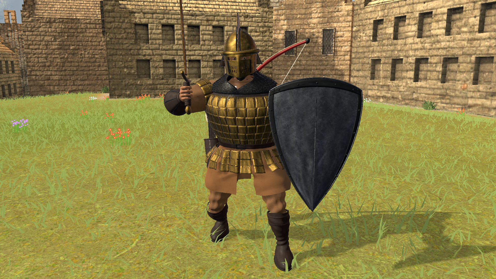 | 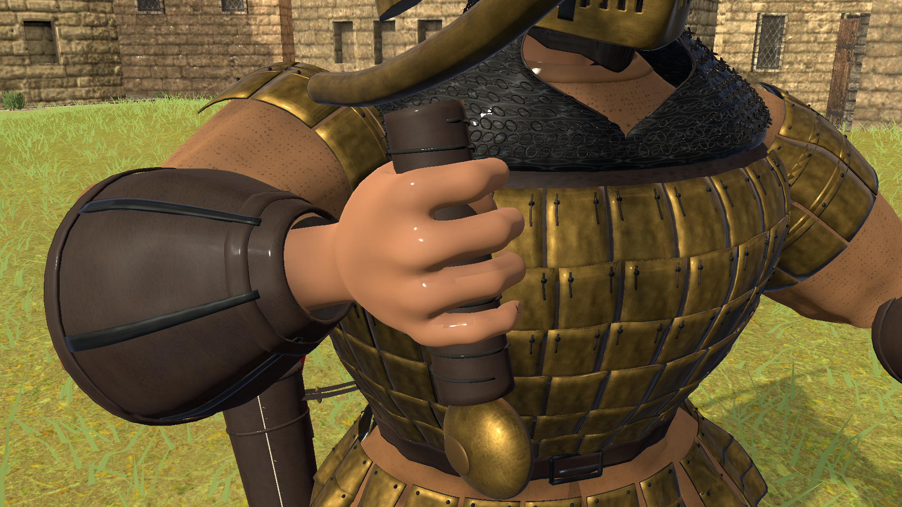 |

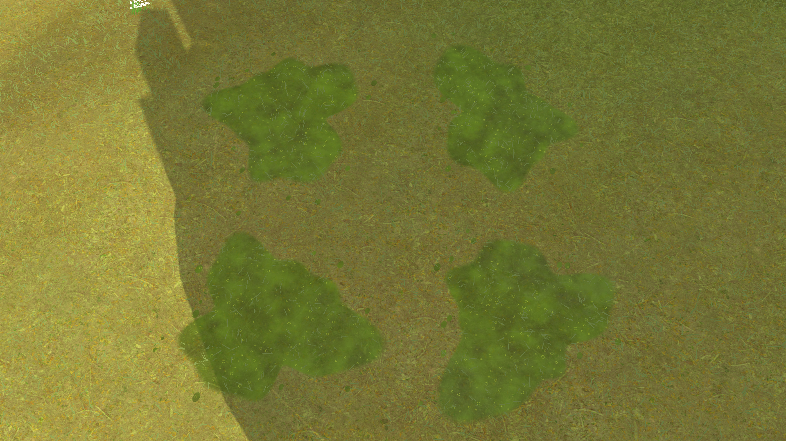

## Game overview

| | |
|---|---|
| 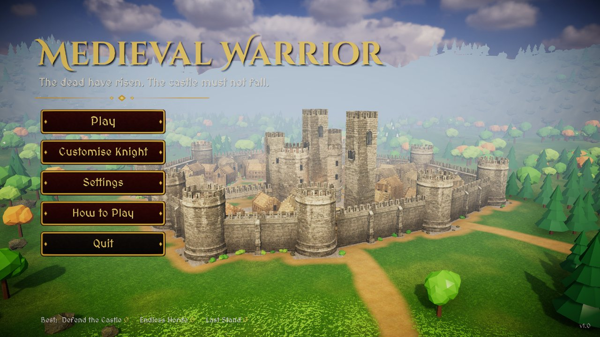 | 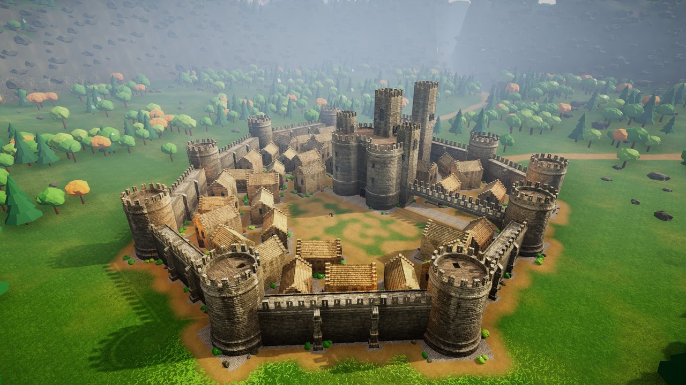 |
| 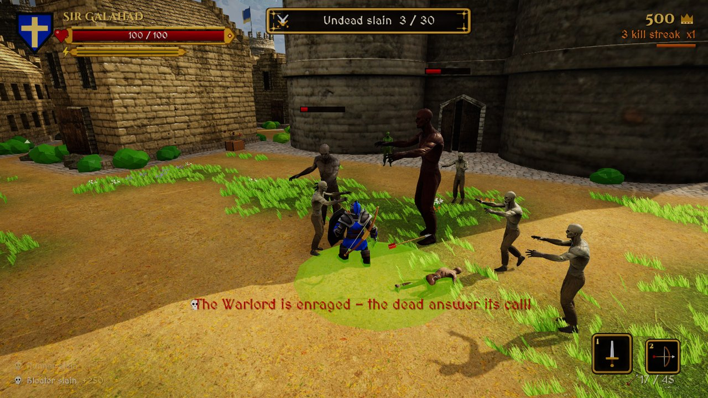 | 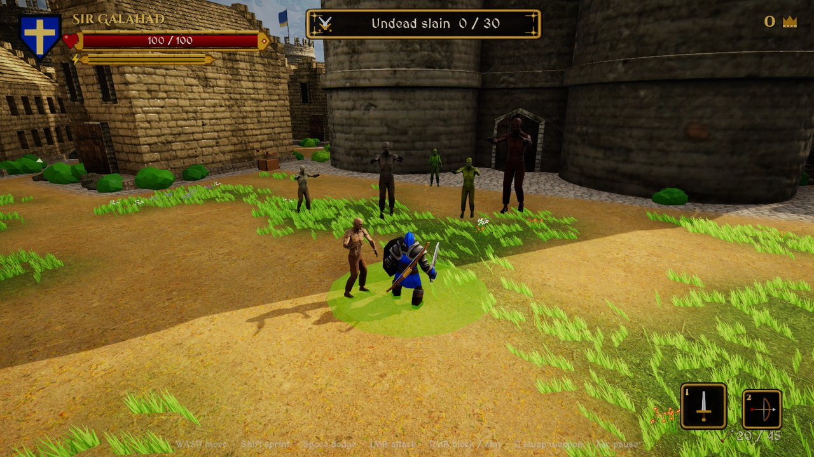 |
| 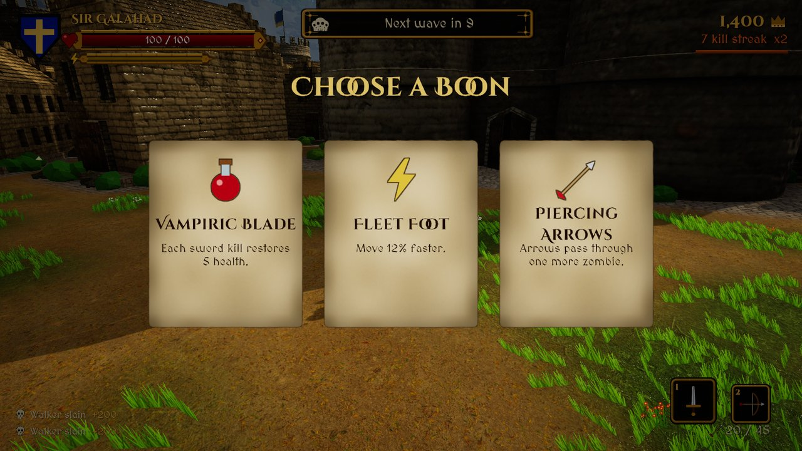 | 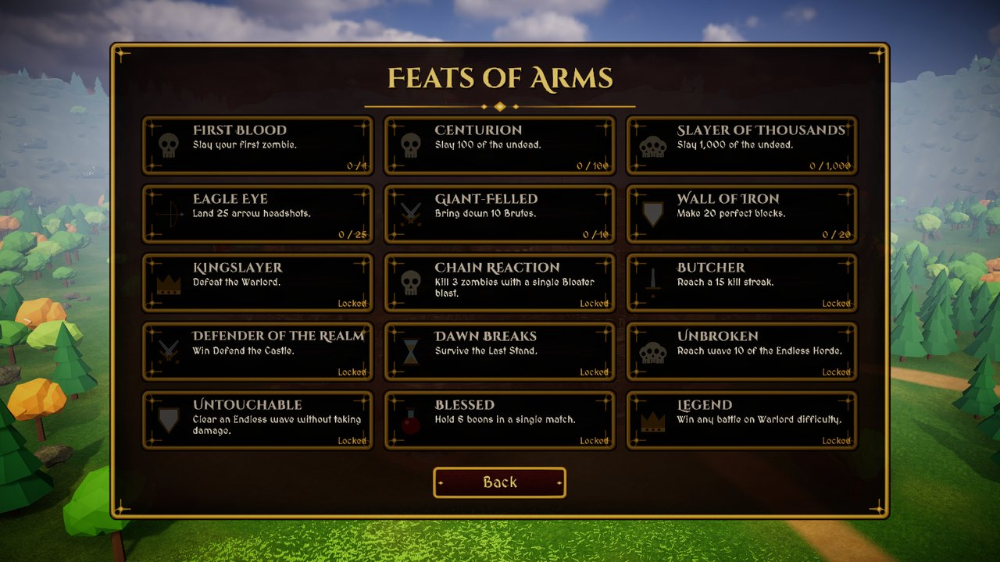 |
| 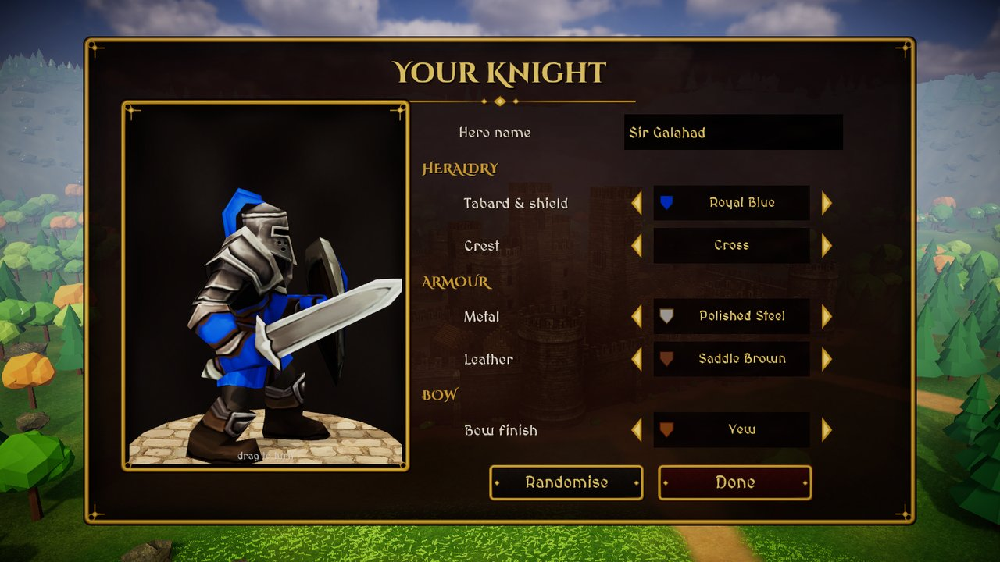 | 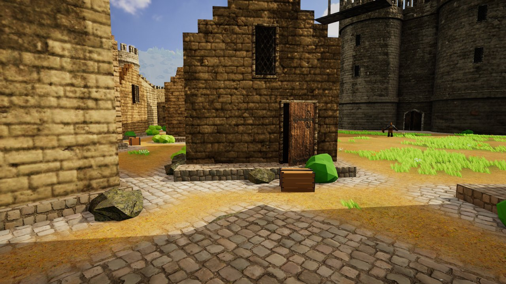 |

---

## Features

**Combat**
- **Rapid sword styles**: twelve authored cuts and thrusts, buffered combos and
  synchronized strike contact. [Combat and cloth details](ArtSource/Marchwarden/CombatCloth.md).
- **Live tunic cloth**: a pinned waist, real-time fabric motion and fitted thigh,
  calf and foot collision capsules keep the hem clear through movement and combat.
- **Sword & shield** – three-hit combo (the third swing deals extra damage), shield block,
  *perfect block* (block just as a hit lands to negate it), *parry* (swing as you are
  struck) and a stamina-costing **shield bash**.
- **Bow & arrow** – press `Q` / `2` to swap; hold left mouse to draw (a fuller draw flies
  further and hits harder), right mouse aims over the shoulder.
  Headshots do double damage. The bow is slung on your back while you use the sword.
- **Archer stance** – the knight turns side-on, extends the bow arm down the line of the shot and
  draws the string back to his cheek (procedural IK on the skeleton). With the bow out, his sword is
  sheathed on his hip and his shield slung on his back.
- **Arrows can be recovered** – missed arrows stick in the ground, arrows in a zombie drop when it
  dies; walk over them to pick them back up.
- **Arrows** wait on **supply crates** beside the houses (they restock over time) and drop from
  fallen zombies, along with healing draughts.
- **Stamina** for sprinting, dodge rolls (brief invulnerability) and shield bashes.
- Continuous combat through damage, screen shake, blood/sparks, damage numbers, kill streak score multiplier.
- War drums swell in as the horde closes in and fade when the field is clear.

**Enemies** – all built from the same zombie art so they look like one horde:

| Zombie  | What it does |
|---------|--------------|
| Walker  | The shambling dead. Slow, but never alone. |
| Runner  | Fast rear flanks, short lunges and quick breakaways. Turn to face it to interrupt the windup. |
| Brute   | Huge and slow; its ground slam throws you across the yard. Hard to bring down. |
| Spitter | Keeps its distance and lobs bile that leaves irregular, ground-following acid puddles. |
| Bloater | Swells up and bursts when close or when killed – it hurts other zombies too. |
| Warlord | Boss. Lots of health, enrages at half health. |

The zombie AI takes turns: only a few may attack at once while the others **circle and wait
for an opening**. They **rise out of the ground** at random reachable spots all over the map,
sidestep when they get stuck, path around buildings (NavMesh) and relocate if they are ever
cut off.

**World** – the castle crowns a mound; the town's ground rolls and dips, every house, wall and
tower seated on its own levelled, cobbled pad. 2K terrain textures, three kinds of hand-painted
grass, flowers, forests, a mountain ring and roads that run to the real gates.

**Game modes**
- **Defend the Castle** – slay a set number of undead (by difficulty); the Warlord leads the
  final assault.
- **Endless Horde** – escalating waves; every 5th wave brings a Brute champion, every 10th the
  Warlord. Wounds are tended between waves.
- **Last Stand** – survive until dawn (3–5 minutes) while the horde keeps growing.

Three difficulties (Squire / Knight / Warlord). High scores and best wave are saved.

**Boons** – pick one of three upgrades after every Endless wave, at a third and two thirds of the
way through Defend the Castle, and every minute of Last Stand: Vigour, Swift Draw, Keen Edge,
Second Wind, Piercing Arrows, Fire Arrows (fully drawn shots set zombies ablaze), Great Quiver,
Bulwark, Vampiric Blade, Fleet Foot and Bloodlust. They stack and last until the match ends.

**UI** – medieval gold-and-iron interface: ornate health bar with damage trail, stamina bar,
heraldic shield in your colours, objective plaque, combo meter, boss bar, weapon slots and arrow
count, crosshair, hit markers, enemy health bars, off-screen threat arrows, kill feed, banners,
pause menu, end-of-match stats. Main menu over a live fly-around of the castle.

**Feats** – fifteen achievements that persist between sessions (Centurion, Eagle Eye, Kingslayer,
Chain Reaction, Untouchable, Legend, ...) with progress shown in the main menu.

**Customisation** – hero name, tabard/shield colour, crest, armour metal, leather tone and bow
finish, previewed live on a turntable. **Settings** – volumes, mouse sensitivity, invert Y, FOV,
graphics quality, fullscreen, screen shake, damage numbers, FPS counter.

## Controls

| Action | Keyboard & mouse | Gamepad |
|--------|------------------|---------|
| Move | `W A S D` | Left stick |
| Look | Mouse | Right stick |
| Sprint | `Shift` | Left stick click / left bumper |
| Dodge roll | `Space` | A / Cross |
| Sword combo, hold to draw the bow | Left mouse | Right trigger |
| Raise shield (sword) / aim (bow) | Right mouse or `E` | Left trigger |
| Shield bash | Block + left mouse | Block + right trigger |
| Swap weapon | `Q` (or `1` / `2`) | Y / Triangle (d-pad left/right) |
| Zoom | Scroll | D-pad up/down |
| Pause | `Esc` / `P` | Start |

Menus work with the mouse or a controller (d-pad/stick to move, A to choose).

---

## Getting started (for collaborators)

**Full step-by-step guide: [Docs/SETUP.md](Docs/SETUP.md)** (install, first open, package
workaround, building, testing, regenerating assets, troubleshooting). Quick version:

1. Install **Unity 6000.3.2f1** (Unity Hub → Installs → Install Editor → Archive, or any
   `6000.3.x`). No extra modules are needed for Windows.
2. Clone the repo (on Windows keep the path short or run
   `git config --global core.longpaths true` first – some asset-pack paths are long) and open the
   folder in Unity Hub. The first import takes a few minutes;
   Unity downloads the packages listed in `Packages/manifest.json` (including
   `com.unity.postprocessing`).
3. Open `Assets/Scenes/MainMenu.unity` and press **Play**.
   You can also open `Assets/Scenes/Semi-Final.unity` and press Play to jump straight into a
   match – it loads the castle world (`Background.unity`) by itself.

Everything the game needs is committed: terrain data, generated meshes, prefabs, textures,
fonts, UI art and audio. You do **not** need to run any generator to play.

### Build a standalone game
`Medieval Warrior → Build Windows Player` writes `Builds/Windows/MedievalWarrior.exe`
(or use `File → Build Profiles`; the scene list is already set: `MainMenu`, `Semi-Final`, `Background`).
A built game can test itself: `MedievalWarrior.exe -batchmode -autotest -logFile autotest.log`
plays a short match of two modes and exits with code 0 if everything worked.

---

## Project layout

```
Assets/
  Scenes/            MainMenu, Semi-Final (gameplay: player, camera, HUD, spawner), Background (castle world)
  Scripts/           Gameplay code (see below)
    Core/            GameSettings (PlayerPrefs), AudioManager, ProceduralModels (bow/arrows/crates/potions)
    Combat/          Arrow, BileGlob + AcidPool, Pickup, Combat (explosions), FX (particles, shake)
    Enemies/         ZombieTypes (stats for every archetype)
    Player/          Marchwarden visual/cloth/armor rigs, wrist IK, shield defense, quiver suspension and customization
    UI/              UIKit (UI builder), GameHUD, MainMenuUI, SharedPanels (settings/help), MenuPreview, MenuCameraOrbit
    Testing/         SmokeTestDriver and equipped-weapon clearance checks
    EnemyController.cs  PlayerControlSpeed.cs  PlayerHealth.cs  GameManager.cs  ZombieSpawner.cs  CameraFollow.cs  MainController.cs
  Editor/            Environment/gameplay builders, Blender importer, animation authoring and validation tools
  Environment/       Terrain textures/sky (Textures) and everything the builder generates (Generated)
  Resources/         Loaded at runtime: UI sprites, fonts, audio, prop prefabs, FX materials, knight recolour masks
  Animations/        KnightController, ZombieBrain (generated), old ZombieController
  Advance Studios/   Medieval castle asset pack
  Toon_RTS_demo/     Legacy knight / animation rig and clips (retained)
  Resources/Marchwarden/ Original warrior meshes and PBR materials
  Resources/Animations/Sword/ Twelve authored strikes and the ready guard
  Zombie/            Zombie models + animations
ArtSource/Marchwarden/ Compressed editable Blender source, anatomical source/license, references and design notes
Tools/ArtPipeline/   Reproducible Blender construction, rig export helpers and render/audit scripts
Docs/                Developer guide and screenshots
```

See **[Docs/DEVELOPER_GUIDE.md](Docs/DEVELOPER_GUIDE.md)** for how the systems fit together,
how to add a zombie type / weapon / UI screen, and how to regenerate the world or run the tests.

## Tools menu (Unity editor)

- **Medieval Warrior → Rebuild Environment** – regenerates terrain, foliage, foundations,
  supply crates, lighting, post-processing, NavMesh, the zombie animator, prop prefabs and the
  menu scene. It is deterministic, but it **replaces** anything under the `Environment` object
  and the generated assets, so commit your work first.
- **Medieval Warrior → Run Smoke Test** – plays through every menu and mode automatically and
  writes a PASS/FAIL report plus screenshots to `Temp/SmokeShots`.
- **Medieval Warrior → Build Windows Player** – builds `Builds/Windows/MedievalWarrior.exe`.
- **Medieval Warrior → Marchwarden → Export animation rig reference** / **Import Blender exports** – exchange the shared rig and generated character meshes with Blender.
- **Medieval Warrior → Rebuild sword animations** – regenerates the twelve strikes and ready guard from the shared combat timings.
- **Medieval Warrior → Review sword and shield clearance** – samples strikes, combo blends, defense, palm attachments and wrist bend.

## Validation and art regeneration

The latest complete run passed **240 gameplay checks** and **48 combat/pose checks**,
with no gameplay errors or exceptions. Both hand/forearm meshes also passed the
closed-topology and face-orientation audit. Committed reports:

- [Gameplay regression](Docs/validation/2026-11-08-gameplay.txt)
- [Combat, defense and wrist clearance](Docs/validation/2026-11-08-combat-clearance.txt)
- [Hand topology audit](Docs/validation/2026-11-08-hand-topology.json)

The gameplay suite covers the menus and modes, all zombie types, damage continuity,
Runner rear attacks, movement and combos, cloth/armor/quiver contacts, bow aiming,
ammunition, fire arrows and acid footprints. The authoring review samples animations
at 180 Hz and checks combo transitions, shield fit, foot contacts and wrist limits.

Playing or building uses the committed Unity assets and does not require Blender.
To change the model, use **Blender 4.5 LTS** and follow the
[art-source rebuild instructions](ArtSource/Marchwarden/README.md). After exporting
the rig, run `marchwarden.py`, import its meshes in Unity and rebuild the sword
animations. `MarchwardenBuilder.BuildAndSmoke` runs the import, animation review
and gameplay suite after the Blender export has been regenerated.

The editable `.blend` is saved with Blender compression. Local tool downloads,
validation-project copies, logs, screenshots and reproducible `meshes.json` exports
remain ignored; selected screenshots and verification reports are kept under `Docs`.

## Credits & licences

- Castle: *Medieval Castle* by Advance Studios. Knight animation rig and clips: *Toon RTS* demo by Polygon Blacksmith.
  Zombie: *Free Zombie* pack. (Unity Asset Store free assets.)
- Terrain textures and sky HDRI: [Poly Haven](https://polyhaven.com) (CC0), colour-graded for the game.
- Fonts: *Cinzel Decorative* and *MedievalSharp* (SIL Open Font License, see `Assets/Resources/Fonts`).
- UI art, sound effects, music, trees, rocks and props: generated for this project.
- Warrior and equipment: **Marchwarden** armor and kit, authored in Blender from the user's references; anatomical head and hands adapted from MakeHuman's CC0 base, with the source and license retained in [Anatomy](ArtSource/Marchwarden/Anatomy/README.md).
  Editable source and regeneration: [ArtSource/Marchwarden](ArtSource/Marchwarden/README.md).

Project code is MIT licensed – see `LICENSE`. Third-party assets retain their own licences.
