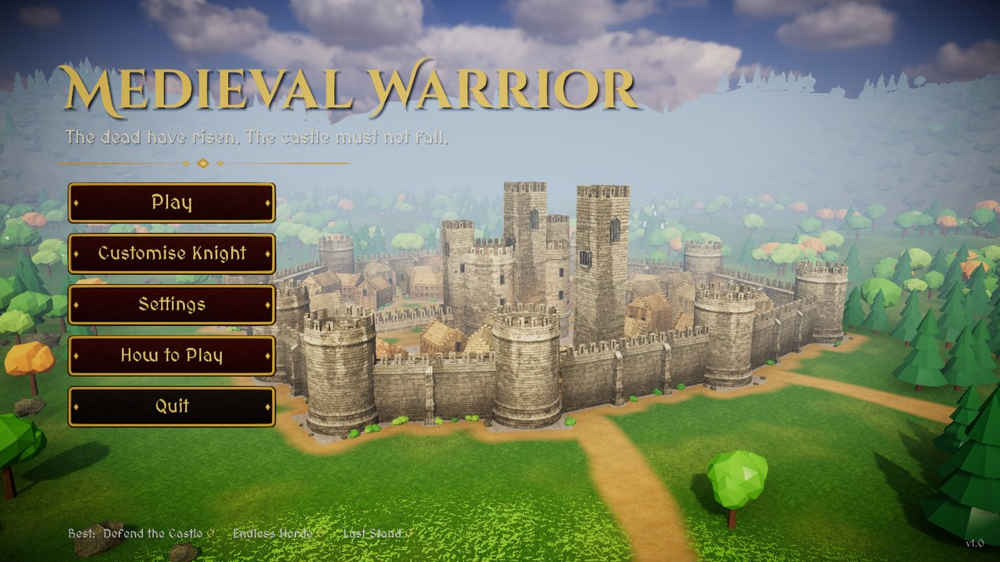
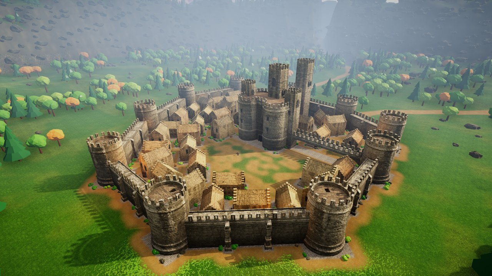
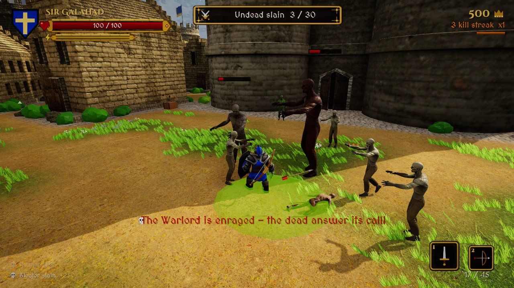
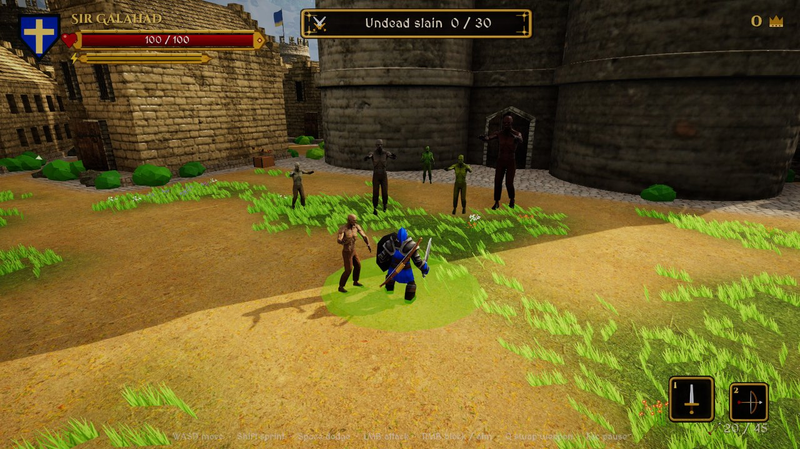
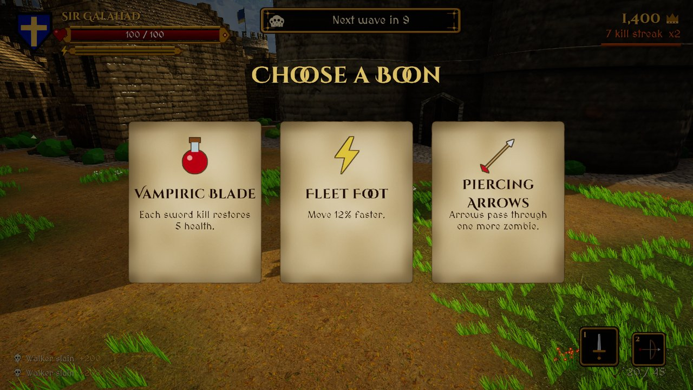
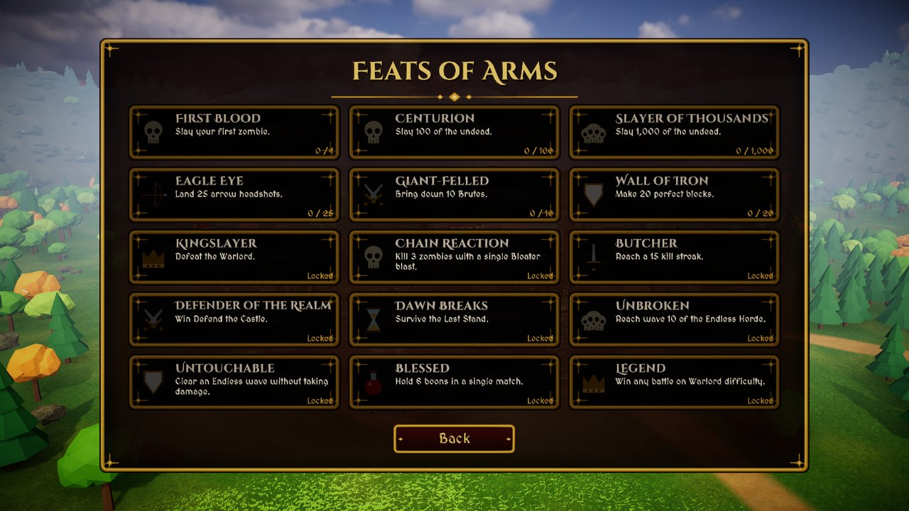
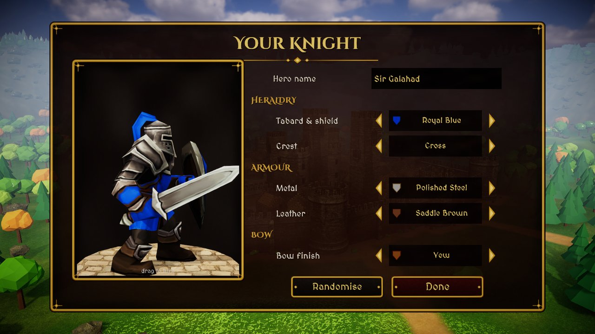
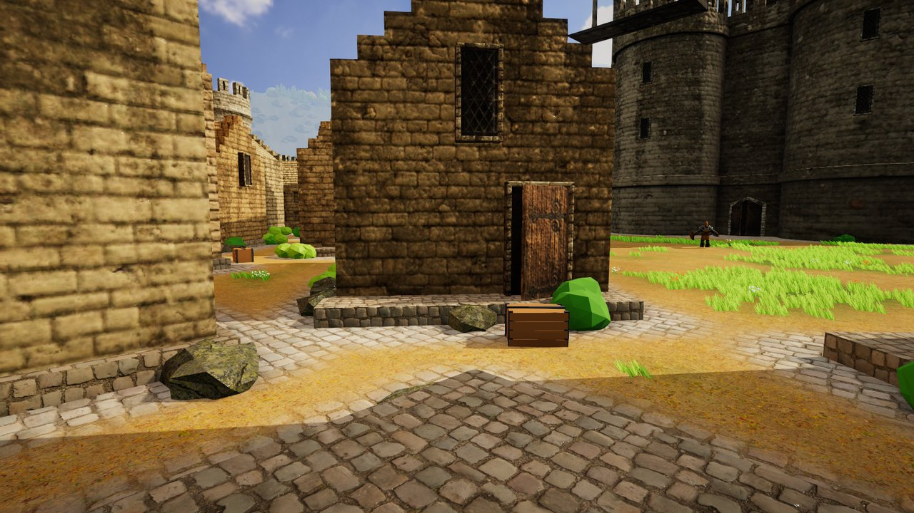

# Medieval Warrior

Fight the undead to save your castle. A third-person medieval action game made in Unity 6
(built-in render pipeline): sword and shield, a bow you can sling on your back, six kinds of
zombie, three game modes, and a fully customisable knight.

| | |
|---|---|
|  |  |
|  |  |
|  |  |
|  |  |

---

## Features

**Combat**
- **Sword & shield** – three-hit combo (the third swing knocks enemies back), shield block,
  *perfect block* (block just as a hit lands to stun the attacker), *parry* (swing as you are
  struck) and a stamina-costing **shield bash**.
- **Bow & arrow** – press `Q` / `2` to swap; hold left mouse to draw (a fuller draw flies
  further, hits harder and knocks zombies back), right mouse aims over the shoulder.
  Headshots do double damage. The bow is slung on your back while you use the sword.
- **Archer stance** – the knight turns side-on, extends the bow arm down the line of the shot and
  draws the string back to his cheek (procedural IK on the skeleton). With the bow out, his sword is
  sheathed on his hip and his shield slung on his back.
- **Arrows can be recovered** – missed arrows stick in the ground, arrows in a zombie drop when it
  dies; walk over them to pick them back up.
- **Arrows** wait on **supply crates** beside the houses (they restock over time) and drop from
  fallen zombies, along with healing draughts.
- **Stamina** for sprinting, dodge rolls (brief invulnerability) and shield bashes.
- Hit-stop, screen shake, blood/sparks, damage numbers, kill streak score multiplier.
- War drums swell in as the horde closes in and fade when the field is clear.

**Enemies** – all built from the same zombie art so they look like one horde:

| Zombie  | What it does |
|---------|--------------|
| Walker  | The shambling dead. Slow, but never alone. |
| Runner  | Sprints in and lunges from range. |
| Brute   | Huge and slow; its ground slam throws you across the yard. Resists knockback. |
| Spitter | Keeps its distance and lobs bile that leaves burning acid pools. |
| Bloater | Swells up and bursts when close or when killed – it hurts other zombies too. |
| Warlord | Boss. Lots of health, enrages at half health. |

The zombie AI takes turns: only a few may attack at once while the others **circle and wait
for an opening**. They **rise out of the ground** at random reachable spots all over the map,
sidestep when they get stuck, path around buildings (NavMesh) and relocate if they are ever
cut off.

**World** – the castle crowns a mound; the town's ground rolls and dips, every house, wall and
tower seated on its own levelled, cobbled pad. 2K terrain textures, three kinds of hand-painted
grass, flowers, forests, a mountain ring and roads that run to the real gates.

**Game modes**
- **Defend the Castle** – slay a set number of undead (by difficulty); the Warlord leads the
  final assault.
- **Endless Horde** – escalating waves; every 5th wave brings a Brute champion, every 10th the
  Warlord. Wounds are tended between waves.
- **Last Stand** – survive until dawn (3–5 minutes) while the horde keeps growing.

Three difficulties (Squire / Knight / Warlord). High scores and best wave are saved.

**Boons** – pick one of three upgrades after every Endless wave, at a third and two thirds of the
way through Defend the Castle, and every minute of Last Stand: Vigour, Swift Draw, Keen Edge,
Second Wind, Piercing Arrows, Fire Arrows (fully drawn shots set zombies ablaze), Great Quiver,
Bulwark, Vampiric Blade, Fleet Foot and Bloodlust. They stack and last until the match ends.

**UI** – medieval gold-and-iron interface: ornate health bar with damage trail, stamina bar,
heraldic shield in your colours, objective plaque, combo meter, boss bar, weapon slots and arrow
count, crosshair, hit markers, enemy health bars, off-screen threat arrows, kill feed, banners,
pause menu, end-of-match stats. Main menu over a live fly-around of the castle.

**Feats** – fifteen achievements that persist between sessions (Centurion, Eagle Eye, Kingslayer,
Chain Reaction, Untouchable, Legend, ...) with progress shown in the main menu.

**Customisation** – hero name, tabard/shield colour, crest, armour metal, leather tone and bow
finish, previewed live on a turntable. **Settings** – volumes, mouse sensitivity, invert Y, FOV,
graphics quality, fullscreen, screen shake, damage numbers, FPS counter.

## Controls

| Action | Keyboard & mouse | Gamepad |
|--------|------------------|---------|
| Move | `W A S D` | Left stick |
| Look | Mouse | Right stick |
| Sprint | `Shift` | Left stick click / left bumper |
| Dodge roll | `Space` | A / Cross |
| Sword combo, hold to draw the bow | Left mouse | Right trigger |
| Raise shield (sword) / aim (bow) | Right mouse or `E` | Left trigger |
| Shield bash | Block + left mouse | Block + right trigger |
| Swap weapon | `Q` (or `1` / `2`) | Y / Triangle (d-pad left/right) |
| Zoom | Scroll | D-pad up/down |
| Pause | `Esc` / `P` | Start |

Menus work with the mouse or a controller (d-pad/stick to move, A to choose).

---

## Getting started (for collaborators)

**Full step-by-step guide: [Docs/SETUP.md](Docs/SETUP.md)** (install, first open, package
workaround, building, testing, regenerating assets, troubleshooting). Quick version:

1. Install **Unity 6000.3.2f1** (Unity Hub → Installs → Install Editor → Archive, or any
   `6000.3.x`). No extra modules are needed for Windows.
2. Clone the repo (on Windows keep the path short or run
   `git config --global core.longpaths true` first – some asset-pack paths are long) and open the
   folder in Unity Hub. The first import takes a few minutes;
   Unity downloads the packages listed in `Packages/manifest.json` (including
   `com.unity.postprocessing`).
3. Open `Assets/Scenes/MainMenu.unity` and press **Play**.
   You can also open `Assets/Scenes/Semi-Final.unity` and press Play to jump straight into a
   match – it loads the castle world (`Background.unity`) by itself.

Everything the game needs is committed: terrain data, generated meshes, prefabs, textures,
fonts, UI art and audio. You do **not** need to run any generator to play.

### Build a standalone game
`Medieval Warrior → Build Windows Player` writes `Builds/Windows/MedievalWarrior.exe`
(or use `File → Build Profiles`; the scene list is already set: `MainMenu`, `Semi-Final`, `Background`).
A built game can test itself: `MedievalWarrior.exe -batchmode -autotest -logFile autotest.log`
plays a short match of two modes and exits with code 0 if everything worked.

---

## Project layout

```
Assets/
  Scenes/            MainMenu, Semi-Final (gameplay: player, camera, HUD, spawner), Background (castle world)
  Scripts/           Gameplay code (see below)
    Core/            GameSettings (PlayerPrefs), AudioManager, ProceduralModels (bow/arrows/crates/potions)
    Combat/          Arrow, BileGlob + AcidPool, Pickup, Combat (explosions), FX (particles, hit-stop, shake)
    Enemies/         ZombieTypes (stats for every archetype)
    Player/          KnightAppearance (armour recolouring)
    UI/              UIKit (UI builder), GameHUD, MainMenuUI, SharedPanels (settings/help), MenuPreview, MenuCameraOrbit
    Testing/         SmokeTestDriver (editor-only automated play-through)
    EnemyController.cs  PlayerControlSpeed.cs  PlayerHealth.cs  GameManager.cs  ZombieSpawner.cs  CameraFollow.cs  MainController.cs
  Editor/            EnvironmentBuilder, GameplayBuilder, SmokeTest  (tools, not shipped)
  Environment/       Terrain textures/sky (Textures) and everything the builder generates (Generated)
  Resources/         Loaded at runtime: UI sprites, fonts, audio, prop prefabs, FX materials, knight recolour masks
  Animations/        KnightController, ZombieBrain (generated), old ZombieController
  Advance Studios/   Medieval castle asset pack
  Toon_RTS_demo/     Knight model + animations
  Zombie/            Zombie models + animations
Docs/                Developer guide and screenshots
```

See **[Docs/DEVELOPER_GUIDE.md](Docs/DEVELOPER_GUIDE.md)** for how the systems fit together,
how to add a zombie type / weapon / UI screen, and how to regenerate the world or run the tests.

## Tools menu (Unity editor)

- **Medieval Warrior → Rebuild Environment** – regenerates terrain, foliage, foundations,
  supply crates, lighting, post-processing, NavMesh, the zombie animator, prop prefabs and the
  menu scene. It is deterministic, but it **replaces** anything under the `Environment` object
  and the generated assets, so commit your work first.
- **Medieval Warrior → Run Smoke Test** – plays through every menu and mode automatically and
  writes a PASS/FAIL report plus screenshots to `Temp/SmokeShots`.
- **Medieval Warrior → Build Windows Player** – builds `Builds/Windows/MedievalWarrior.exe`.

## Credits & licences

- Castle: *Medieval Castle* by Advance Studios. Knight: *Toon RTS* demo by Polygon Blacksmith.
  Zombie: *Free Zombie* pack. (Unity Asset Store free assets.)
- Terrain textures and sky HDRI: [Poly Haven](https://polyhaven.com) (CC0), colour-graded for the game.
- Fonts: *Cinzel Decorative* and *MedievalSharp* (SIL Open Font License, see `Assets/Resources/Fonts`).
- UI art, sound effects, music, trees, rocks and props: generated for this project.

MIT licensed – see `LICENSE`.
